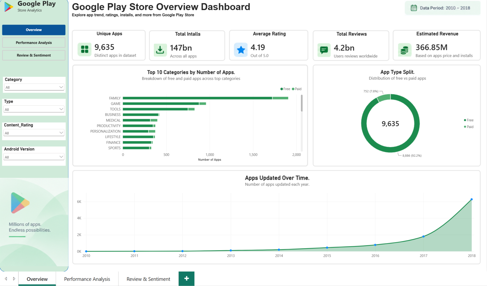
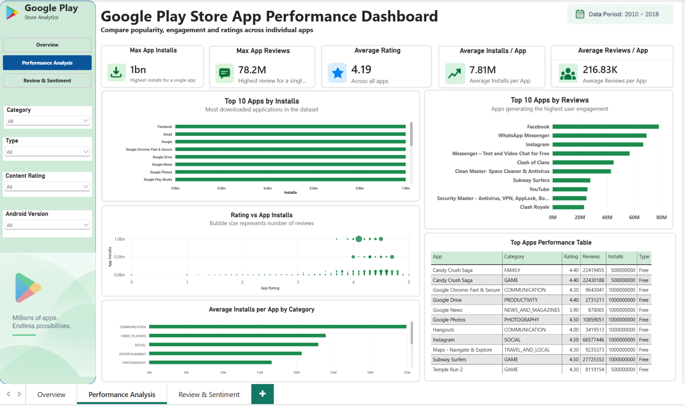
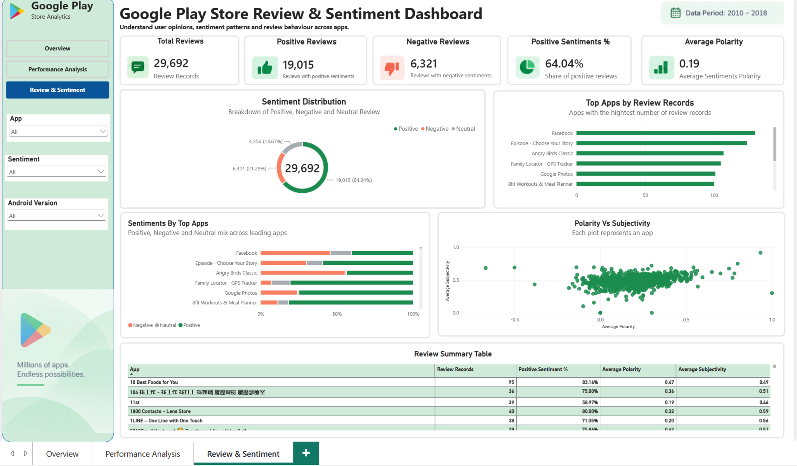

# Google Play Store Analytics

**End-to-end data analytics project using Python, Google Sheets, Microsoft SQL Server and Power BI to analyse app performance, market adoption and user sentiment across the Google Play Store.**

---

## Dashboard Preview

### 1. Google Play Store Overview



This dashboard provides a high-level view of the Google Play Store dataset, including app volume, installs, ratings, reviews, estimated revenue, category performance and app update trends.

### 2. App Performance Analysis



This page focuses on individual app performance, highlighting the most installed and most reviewed applications, rating patterns, category-level performance and the relationship between ratings and installs.

### 3. Review & Sentiment Analysis



This dashboard analyses user feedback through positive, negative and neutral sentiment, review volume, sentiment polarity and subjectivity.

---

## Project Overview

The Google Play Store contains thousands of applications across different categories, pricing models and levels of user engagement.

However, raw app-store data contains duplicate records, missing values, inconsistent formatting and malformed observations that must be resolved before meaningful analysis can be performed.

This project follows the complete analytics lifecycle:

**Raw Data → Python Cleaning → Google Sheets Validation → SQL Server Analysis → Power BI Modelling → Interactive Dashboards**

The aim was to transform raw Google Play Store application and user-review data into an interactive business intelligence solution capable of answering questions about:

- App popularity
- Installs and market adoption
- Ratings
- User engagement
- Free and paid applications
- Estimated paid-app revenue
- Category and genre performance
- User sentiment
- Sentiment polarity
- Sentiment subjectivity

---

## Business Questions

The project was designed to answer questions such as:

1. Which apps have the highest number of installs?
2. Which applications receive the highest number of reviews?
3. Which categories generate the greatest total installs?
4. Which categories achieve the highest average ratings?
5. How are Free and Paid applications distributed?
6. Which categories contain the largest number of paid apps?
7. Which paid applications are the most expensive?
8. What is the estimated revenue generated from paid-app purchases?
9. Does a higher app rating necessarily correspond with higher installs?
10. What proportion of user reviews are Positive, Neutral or Negative?
11. Which applications generate the greatest review activity?
12. How do sentiment polarity and subjectivity vary across applications?

---

## Tools & Technologies

| Tool | Purpose |
|---|---|
| **Python** | Data preprocessing, cleaning and quality checks |
| **Pandas** | Data transformation and manipulation |
| **NumPy** | Validation and unique-value analysis |
| **Google Sheets** | Spreadsheet-based cleaning and validation |
| **Microsoft SQL Server** | Data storage, querying and analysis |
| **SQL Server Management Studio** | Database development and analytical querying |
| **Power BI** | Data modelling, DAX calculations and dashboard development |

---

## Dataset

The project used two Google Play Store datasets.

### Applications Dataset

The raw applications dataset contained information including:

- App
- Category
- Rating
- Reviews
- Size
- Installs
- Type
- Price
- Content Rating
- Genres
- Last Updated
- Current Version
- Android Version

After preprocessing, the final Apps dataset contained **10,354 records** representing **9,635 distinct applications**.

### Reviews Dataset

The user-review dataset contained:

- App
- Translated Review
- Sentiment
- Sentiment Polarity
- Sentiment Subjectivity

After duplicate removal and data-quality checks, the final Reviews dataset contained **29,692 valid review records**.

---

## Data Cleaning & Transformation

The raw datasets required significant preprocessing before analysis.

### Apps Dataset

The cleaning process included:

- Removing exact duplicate records
- Identifying malformed observations
- Correcting datatype inconsistencies
- Handling missing ratings
- Validating numeric columns
- Standardising application fields
- Checking category and pricing values
- Validating the cleaned dataset after spreadsheet processing

One malformed record contained values shifted into incorrect columns, including an impossible rating of **19**. Rather than reconstructing the row using unsupported assumptions, the corrupted record was removed.

A later validation check also detected a Google Sheets-related `#NAME?` issue that affected an application record. The affected rating was traced back to the pre-spreadsheet dataset and restored correctly.

This reinforced the importance of validating data **after every major transformation stage**.

### Reviews Dataset

The Reviews dataset contained a large number of duplicate records.

The cleaning process included:

- Removing exact duplicates
- Removing unusable blank review records
- Checking valid sentiment labels
- Converting sentiment polarity to numeric values
- Converting sentiment subjectivity to numeric values
- Validating polarity between **-1 and +1**
- Validating subjectivity between **0 and 1**

The final dataset contained:

- **29,692 review records**
- **0 duplicate rows**
- **0 missing translated reviews**
- **0 invalid polarity values**
- **0 invalid subjectivity values**

---

## SQL Analysis

The cleaned datasets were imported into **Microsoft SQL Server** for structured analysis.

Staging tables were used to reduce datatype and CSV-import problems before data was transferred into the final analytical tables.

SQL techniques used included:

- `SELECT`
- `DISTINCT`
- `WHERE`
- `GROUP BY`
- `ORDER BY`
- `TOP`
- `WITH TIES`
- `COUNT`
- `SUM`
- `AVG`
- `MAX`
- Subqueries
- `TRY_CONVERT`
- SQL Views

A reusable SQL view called:

`App_Analysis_View`

was created as a clean analytical source.

---

## Power BI Data Model

A dedicated application dimension was created to prevent an unnecessary many-to-many relationship between the Apps and Reviews datasets.

The model structure is:

```text
Google_Play_Store_Apps (*)
          |
          | many-to-one
          |
       DimApp (1)
          |
          | one-to-many
          |
Google_Play_Store_Reviews (*)
```

`DimApp` contains a unique list of application names and acts as the common filtering dimension for both analytical tables.

---

## DAX Measures

Measures created in Power BI included:

- Unique Apps
- Total Installs
- Average Rating
- Total Reviews
- Estimated Revenue
- Max App Installs
- Max App Reviews
- Average Installs per App
- Average Reviews per App
- Review Records
- Positive Reviews
- Negative Reviews
- Neutral Reviews
- Positive Sentiment %
- Average Polarity
- Average Subjectivity
- App Installs
- App Reviews
- App Rating

---

## Key Results

### Store Overview

- **9,635** distinct applications were analysed.
- The dataset recorded approximately **147 billion installs**.
- Average app rating was approximately **4.19**.
- Estimated paid-app revenue, based on **Price × Installs**, was approximately **$366.85 million**.

### App Performance

- **Facebook** recorded the highest review count in the Apps dataset.
- The **GAME** category generated the highest total number of installs.
- **Communication** apps achieved the highest average installs per app.
- Several applications achieved perfect **5.0 ratings**, but many had relatively low install volumes.
- This demonstrates that a perfect rating does not necessarily translate into broad market adoption.

### Sentiment Analysis

The final 29,692 user-review records were distributed as follows:

| Sentiment | Reviews | Percentage |
|---|---:|---:|
| Positive | 19,015 | 64.04% |
| Negative | 6,321 | 21.29% |
| Neutral | 4,356 | 14.67% |
| **Total** | **29,692** | **100%** |

Positive reviews represented almost two-thirds of the analysed review data.

---

## Key Insights

### Ratings alone do not determine market success

Some applications with perfect 5.0 ratings had relatively small install bases, while applications rated around the mid-to-high 4-star range recorded hundreds of millions or even billions of installs.

This suggests that app performance should be evaluated using multiple measures rather than rating alone.

### Gaming dominates total installs

The GAME category generated the highest cumulative installs, demonstrating the scale of mobile gaming within the dataset.

However, high total category installs do not necessarily mean every app in that category performs equally well.

### Communication apps perform strongly on average

Communication applications achieved the highest average installs per app.

This suggests strong user demand and broad adoption within the category.

### Free applications dominate the ecosystem

The overwhelming majority of applications in the dataset were Free rather than Paid.

This indicates that Google Play Store monetisation is heavily oriented towards free-download models, including advertising, subscriptions and in-app purchases.

### User sentiment is generally positive

**64.04%** of analysed reviews were classified as Positive.

However, the presence of more than 6,000 Negative reviews demonstrates the importance of examining written user feedback alongside numerical ratings.

---

## Business Recommendations

1. **Evaluate app performance using multiple KPIs.**  
   Ratings should be interpreted alongside installs, review volume and sentiment.

2. **Monitor negative user sentiment.**  
   Apps with high adoption but substantial negative sentiment should prioritise recurring usability and customer-experience issues.

3. **Assess both category size and average performance.**  
   A category with high total installs may also contain significantly more competing apps.

4. **Use market-specific monetisation strategies.**  
   Since Free apps dominate the dataset, developers targeting mass-market users may benefit from freemium, advertising, subscription or in-app-purchase models rather than relying solely on upfront payment.

5. **Treat customer reviews as strategic product data.**  
   Sentiment polarity and subjectivity can reveal issues that may not be visible from star ratings alone.

---

## Project Challenges & Lessons Learned

### Data validation must continue throughout the workflow

The Google Sheets `#NAME?` issue demonstrated that data errors can be introduced even after the source dataset has already been cleaned.

### SQL staging tables improve reliability

Importing CSV data into staging tables before converting fields into their final datatypes provided greater control over invalid values and reduced import failures.

### Aggregation choices matter

Using inappropriate aggregations can significantly distort results.

For example, summing application ratings generated impossible values above 5.0. App-level measures using `MAX()` were therefore used where repeated records represented the same application.

### Data modelling affects dashboard behaviour

Creating a dedicated `DimApp` dimension enabled both the Apps and Reviews datasets to be analysed without creating a problematic direct many-to-many relationship.

---

## Repository Contents

| File | Description |
|---|---|
| `Google_Play_Store_Analysis.ipynb` | Python data cleaning and preprocessing notebook |
| `Google_Play_Store_SQL_Analysis.sql` | SQL queries and analytical scripts |
| `Google_Play_Store_Analytics_Final.pbix` | Final interactive Power BI report |
| `apps_final_clean.csv` | Cleaned Google Play Store applications dataset |
| `reviews_final_clean.csv` | Cleaned Google Play Store reviews dataset |
| `Overview-dashboard.png` | Dashboard 1 — Google Play Store Overview |
| `performance-analysis-dashboard.png` | Dashboard 2 — App Performance Analysis |
| `sentiment-analysis-dashboard.png` | Dashboard 3 — Review & Sentiment Analysis |

---

## Skills Demonstrated

`Python` • `Pandas` • `NumPy` • `Data Cleaning` • `Exploratory Data Analysis` • `Google Sheets` • `SQL Server` • `SQL` • `Data Validation` • `Power BI` • `Power Query` • `DAX` • `Data Modelling` • `Dashboard Design` • `Sentiment Analysis` • `Business Intelligence` • `Data Storytelling`

---

## Project Outcome

This project transformed raw Google Play Store datasets into a complete analytics solution:

**Raw Data → Cleaned Data → SQL Database → Analytical Queries → Power BI Data Model → Interactive Dashboards → Business Insights**

The project demonstrates the ability to work across the full data analytics lifecycle, from cleaning and validating raw data to building an interactive business intelligence solution and communicating actionable insights.

---

## Author

**DML Global**
